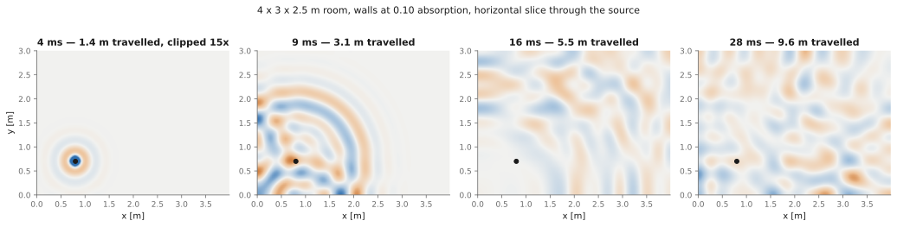
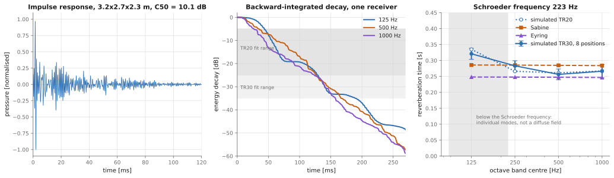

# ac-fdtd

**Room impulse responses from first principles.** A 3D finite-difference time-domain solver for
linear acoustics: a staggered pressure–velocity scheme with locally reacting walls, an absorbing
layer for free field, and ISO 9613-1 air absorption — validated at every step against cases
where an exact answer exists, and then made fast enough to be useful.



*A pulse crossing a 4 × 3 × 2.5 m room. The expanding wavefront, the first reflections arriving
from each wall, and by 28 ms the interference pattern that is the beginning of a reverberant
field.*

---

## What it does

- **Rooms.** Rectangular geometry, walls specified by absorption coefficient or admittance,
  from rigid to impedance-matched.
- **Free field.** A graded matched layer, with its reflection measured rather than assumed.
- **Air.** The full ISO 9613-1 attenuation — classical losses plus oxygen and nitrogen
  relaxation — as a property of the medium, parameterised by temperature, humidity and pressure.
- **Output.** Band-limited excitation, deconvolution, receivers, wav export at 48 kHz, and the
  usual room-acoustics parameters: Schroeder decay, T20/T30, EDT, C50.
- **Speed.** Three interchangeable backends — NumPy (reference), PyTorch (CPU/MPS/CUDA), and a
  compiled C loop — plus a pressure-only variant five times faster again.

```python
from ac_fdtd import Room, simulate_impulse_response, write_wav

room = Room(dimensions=(5.0, 4.0, 3.0), absorption=0.15)
response = simulate_impulse_response(
    room,
    source=(1.0, 1.0, 1.2),
    receivers=[(3.5, 2.5, 1.4)],
    max_frequency=1000.0,
)
write_wav("room.wav", response.signals, response.sample_rate)
```

```bash
uv sync --extra dev && uv run pytest      # 100 tests
uv sync --extra torch                     # optional GPU path; the C one needs only a compiler
```

---

## Does it work?

Every claim below is a measurement, reproducible by one script in `scripts/`. The full log,
with conditions and figures, is in [`PROGRESS.md`](PROGRESS.md).

| What is checked | Against | Result |
| --- | --- | --- |
| Energy conservation, lossless rigid box | exact identity | **4.4e-16** over 4000 steps |
| A single mode stays a single mode | exact discrete eigenmode | **1.3e-13** over 3000 steps |
| Modal frequencies of a rigid box | closed form | second order, **4.0×** per halving of `dx` |
| Free-field monopole | spherical Green's function | **0.21 %** at 61 points/wavelength |
| Wall reflection coefficient | `(1−ξ)/(1+ξ)` | within **0.005** of theory |
| Air absorption | ISO 9613-1, 20–80 % RH | within **1.2 %** above 20 points/wavelength |
| Reverberation time | Sabine and Eyring | **6–8 %** of Eyring above the Schroeder frequency |

The last row is the only one whose reference is not exact, and it is the interesting one: below
the Schroeder frequency the simulation departs from Sabine by 35 %, **which is the correct
answer**. A small room there is a handful of separately decaying modes rather than a diffuse
field, and Sabine's derivation does not apply. Agreement in that band would have meant the code
was reproducing the formula instead of the physics.



---

## Three findings worth the read

### 1. The half time step between pressure and velocity is not an implementation detail

Pressure lives at whole steps and velocity at half steps, so anything combining them — energy,
intensity, a boundary condition — has to name an instant. Getting it wrong does not blow up; it
quietly biases the result by O(dt).

That discipline pays for itself through the **energy identity**. With rigid walls the discrete
divergence and gradient are exact negative adjoints, so the discrete energy is conserved
*exactly* — and it caught sign errors, off-by-one slices and mistimed boundary updates that
showed up nowhere else. The same run scored with the naive `p² + v²` energy oscillates by 7.7 %
instead: not a worse diagnostic, but no diagnostic at all.

The absorbing wall is the same idea applied twice. Imposing `v = Y p` directly is off by half a
step, and the sign of that error decides whether the wall gains or loses energy — which is the
usual reason FDTD boundaries go unstable. Centring it in time gives an implicit condition that
still solves in closed form within a single cell, and edges and corners then need no special
case at all: the coefficients simply add.

### 2. The compiled CPU loop beats the GPU — because of bytes moved, not bandwidth

| grid | NumPy fp64 | Torch CPU fp32 | Torch MPS fp32 | C fp32 | C fp32, pressure-only |
| --- | --- | --- | --- | --- | --- |
| 64³ | 0.21 | 0.18 | 0.89 | 1.07 | 2.86 |
| 256³ | 0.20 | 1.43 | 2.86 | **4.06** | **19.3** |
| 384³ | 0.21 | 1.75 | 2.84 | **4.20** | **18.6** |

Billions of cell-updates per second on an M2 Ultra, from a single run of
`scripts/backend_benchmark.py` (about 10 % run-to-run variance). MPS has more than twice the
CPU's streaming bandwidth — 710 against 333 GB/s, measured rather than quoted — and loses
anyway. PyTorch on the CPU runs at nearly the streaming
ceiling — about as efficient per byte as the machine gets — and still loses by 2×, because a
step written as whole-array operations moves about forty passes over memory where a fused loop
moves 48 bytes per cell.

Eliminating velocity entirely (the second-order wave equation on pressure alone) removes half
the fields and is **five times faster again**, at 87 % of the machine's streaming bandwidth. It
reproduces the pressure–velocity scheme to round-off — the two are algebraically the same
scheme — and currently supports rigid walls only.

So the order of operations for speed is: **fix the resolution, fuse the loop, then choose the
device.** Not the order the hardware specifications suggest.

### 3. The expensive decision is the resolution, and "ten points per wavelength" has a number


The scheme's dispersion relation is closed-form, so this costs nothing to compute. At the
stability limit the scheme is **exact along the body diagonal** — not small, zero, at every
resolution — while the axes are the worst case. Ten points per wavelength buys 1.1 % phase
velocity error; 1 % costs 10.5 points.

That also settles the Courant number. Running below the limit is not a safety margin: it breaks
the cancellation and needs 60 % more cells *and* twice the steps for the same accuracy. Three
times the run time to be more careful, spent on being less accurate.

Since cost scales as the fourth power of bandwidth, this is the highest-leverage number in the
project — halving the required resolution is worth 16× in run time, more than the spread
between the fastest and slowest backend.

**What a room costs** — 5 × 4 × 3 m, one second of impulse response:

| bandwidth | cells | memory | NumPy | Torch MPS | C fp32 | pressure-only |
| --- | --- | --- | --- | --- | --- | --- |
| 1 kHz | 1.7 M | 48 MB | 163 s | 14 s | 15 s | 3 s |
| 2 kHz | 13.8 M | 0.4 GB | 42 min | 3 min | 2 min | **27 s** |
| 4 kHz | 110 M | 2.9 GB | 10.8 h | 47 min | 32 min | **7 min** |
| 8 kHz | 885 M | 23 GB | 173 h | 12.6 h | 8.5 h | **1.9 h** |

---

## Two traps that made correct code look wrong

Both were found by comparing against a closed-form answer, and neither was caught by a test.

**Sabine's formula wants the random-incidence absorption coefficient; a wall admittance is
defined at normal incidence.** A locally reacting surface absorbs far more obliquely — 0.15
head-on is 0.252 averaged over angle, a factor of 1.7 in predicted reverberation time. The first
comparison showed a measured T60 of half the prediction and looked like a serious boundary bug.
The boundaries were right.

**`1.2 / 0.01` is `119.99999999999999`.** So a plain floor put a point on a cell boundary one
cell low, while `0.5 / 0.01` is exact and did not. Two grids of the same spacing disagreed about
where the same point was; it surfaced as a 7 % amplitude error in a free-field comparison and
looked like physics.

---

## Layout

```
src/ac_fdtd/
  scheme.py       the reference solver, and the module docstring worth reading first
  boundaries.py   walls and the absorbing layer
  air.py          ISO 9613-1, and the relaxing medium that has its attenuation
  dispersion.py   what the grid does to the speed of sound
  room.py         the short path: a room, a source, an impulse response
  metrics.py      Schroeder, T20/T30, EDT, C50, Sabine, Eyring
  torch_backend.py · c_backend.py · c/acfdtd.c
scripts/          one per study; each regenerates its own figure
tests/            100 tests, including cross-backend parity
```

| Document | What it is |
| --- | --- |
| [`PLAN.md`](PLAN.md) | Scope, physics, and the validation ladder |
| [`PROGRESS.md`](PROGRESS.md) | The measured log: every result with its conditions |
| [`STATUS.md`](STATUS.md) | Where the project stands and what is next |

## Licence

MIT.
